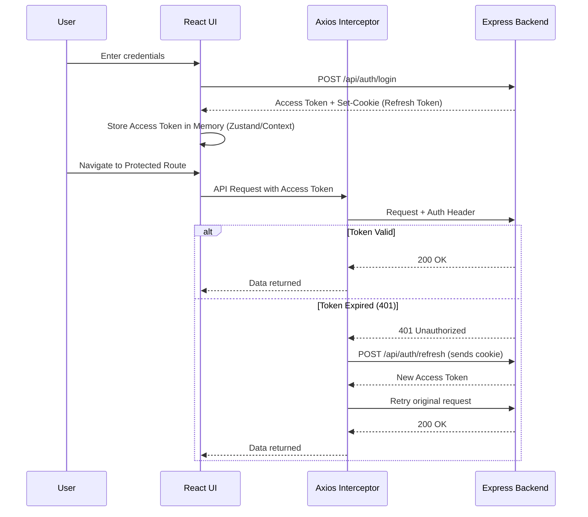

# Phase 1: Foundation & Core Infrastructure (Weeks 1-3)

## 1.1 Project Initialization

### Description
Initialize the foundational architecture of the NearBiz MERN stack platform using a monorepo approach. This phase covers setting up the React frontend, the Express backend, connecting to MongoDB, and configuring shared tooling like ESLint and Prettier.

### Files to Create
- `package.json` (Root monorepo config)
- `frontend/package.json`, `frontend/vite.config.js`, `frontend/tailwind.config.js`
- `backend/package.json`, `backend/server.js`
- `docker-compose.yml`
- `.env`

### Dependencies to Install
**Root (Monorepo setup using workspaces):**
```bash
npm init -y
# Add workspaces to package.json
```

**Frontend:**
```bash
npm create vite@latest frontend -- --template react
cd frontend
npm install react-router-dom axios zustand lucide-react react-hook-form @hookform/resolvers yup
npm install -D tailwindcss postcss autoprefixer eslint prettier
npx tailwindcss init -p
```

**Backend:**
```bash
cd backend
npm init -y
npm install express mongoose dotenv cors helmet morgan jsonwebtoken bcryptjs cookie-parser multer sharp
npm install -D nodemon eslint prettier
```

### Configuration Examples

**docker-compose.yml:**
```yaml
version: '3.8'
services:
  mongodb:
    image: mongo:latest
    ports:
      - "27017:27017"
    volumes:
      - mongodb_data:/data/db
    environment:
      - MONGO_INITDB_ROOT_USERNAME=root
      - MONGO_INITDB_ROOT_PASSWORD=example
volumes:
  mongodb_data:
```

---

## 1.2 Authentication System

### Description
Implement a robust authentication system featuring JWT-based access tokens and httpOnly refresh cookies for secure session management. Role-based access control (RBAC) ensures users have appropriate permissions.

### Mongoose Schemas

```javascript
// backend/models/User.js
const mongoose = require('mongoose');

const userSchema = new mongoose.Schema({
  email: { type: String, required: true, unique: true, lowercase: true },
  password_hash: { type: String, required: true },
  full_name: { type: String, required: true },
  role: { 
    type: String, 
    enum: ['salesperson', 'company_admin', 'super_admin', 'user'],
    default: 'user'
  },
  company_id: { type: mongoose.Schema.Types.ObjectId, ref: 'Company' },
  phone: { type: String },
  avatar: { type: String },
  preferences: { type: Object, default: {} },
  status: { type: String, enum: ['active', 'inactive', 'suspended'], default: 'active' },
  email_verified: { type: Boolean, default: false }
}, { timestamps: true });

module.exports = mongoose.model('User', userSchema);
```

```javascript
// backend/models/RefreshToken.js
const mongoose = require('mongoose');

const refreshTokenSchema = new mongoose.Schema({
  user_id: { type: mongoose.Schema.Types.ObjectId, ref: 'User', required: true },
  token: { type: String, required: true },
  expires_at: { type: Date, required: true },
  revoked: { type: Boolean, default: false }
}, { timestamps: true });

module.exports = mongoose.model('RefreshToken', refreshTokenSchema);
```

### Middleware Code Structure

```javascript
// backend/middleware/auth.js
const jwt = require('jsonwebtoken');

exports.authenticateToken = (req, res, next) => {
  const authHeader = req.headers['authorization'];
  const token = authHeader && authHeader.split(' ')[1];
  
  if (!token) return res.sendStatus(401);

  jwt.verify(token, process.env.JWT_SECRET, (err, user) => {
    if (err) return res.sendStatus(403);
    req.user = user;
    next();
  });
};

exports.requireRole = (...roles) => {
  return (req, res, next) => {
    if (!req.user || !roles.includes(req.user.role)) {
      return res.status(403).json({ message: 'Insufficient permissions' });
    }
    next();
  };
};

exports.requireCompanyAccess = (req, res, next) => {
  // Logic to verify user belongs to req.params.companyId
  next();
};
```

### React Auth Flow Diagram



---

## 1.3 Company Registration & Profiles

### Description
Core system for companies to register, manage profiles, and store their physical locations for map-based discovery. Uses GeoJSON for efficient spatial queries.

### Mongoose Schemas

```javascript
// backend/models/Company.js
const mongoose = require('mongoose');

const addressSchema = new mongoose.Schema({
  label: String,
  address_line: String,
  city: String,
  state: String,
  country: String,
  zip: String,
  location: {
    type: { type: String, enum: ['Point'], default: 'Point' },
    coordinates: { type: [Number], required: true } // [longitude, latitude]
  },
  is_primary: Boolean
});

const companySchema = new mongoose.Schema({
  name: { type: String, required: true },
  slug: { type: String, required: true, unique: true },
  description: String,
  logo: String,
  cover_image: String,
  industry: String,
  business_category: String,
  employee_range: String,
  gstin: String,
  website: String,
  email: String,
  phone: String,
  addresses: [addressSchema],
  operating_locations: [String],
  verification_status: { type: String, enum: ['unverified', 'pending', 'verified'], default: 'unverified' },
  verification_documents: [{ name: String, url: String }],
  feed_visibility_score: { type: Number, default: 0 },
  target_markets: [String],
  settings: { type: Object, default: {} }
}, { timestamps: true });

companySchema.index({ 'addresses.location': '2dsphere' });
module.exports = mongoose.model('Company', companySchema);
```

```javascript
// backend/models/Membership.js
const mongoose = require('mongoose');

const membershipSchema = new mongoose.Schema({
  user_id: { type: mongoose.Schema.Types.ObjectId, ref: 'User', required: true },
  company_id: { type: mongoose.Schema.Types.ObjectId, ref: 'Company', required: true },
  role: { type: String, enum: ['owner', 'admin', 'sales', 'viewer'], default: 'viewer' },
  status: { type: String, enum: ['pending', 'active', 'inactive'], default: 'pending' },
  territory: [String]
}, { timestamps: true });

module.exports = mongoose.model('Membership', membershipSchema);
```

### API Endpoints List

- `POST /api/companies` - Create new company profile
- `GET /api/companies/:slug` - Get company profile details
- `PUT /api/companies/:companyId` - Update company details
- `POST /api/companies/:companyId/upload-logo` - Upload logo image
- `POST /api/memberships` - Add user to company (invite)
- `GET /api/companies/:companyId/members` - List company members

---

## 1.4 Reference Data

### Description
Provide base static data required for dropdowns and categorizations in the application.

### Seeding Script
A basic seeding script `backend/scripts/seed.js` will initialize:
- Industries: Manufacturing, FMCG, Pharma, IT, Healthcare, Agriculture, Construction, Textiles, Automotive, Electronics, Food & Beverage, Chemicals
- Product Categories: Hierarchical (e.g., Electronics -> Components -> Resistors)

---

## 1.5 Week-by-Week Breakdown

- **Week 1:** Project setup (monorepo, Vite, Express, MongoDB connection via Docker). Implement User schema, JWT backend endpoints, and React authentication flow with silent refresh interceptors.
- **Week 2:** Create Company schema, basic CRUD endpoints. Build frontend Company Profile pages (Info, Products, Posts, Meetings layout) and onboarding wizard multi-step form.
- **Week 3:** Implement Membership system tying Users to Companies. Add file upload handling using Multer and Sharp. Seed reference data. Comprehensive integration testing.

---

## 1.6 Testing Checklist

**Authentication Features:**
- [ ] User can register and receives verification email (mocked).
- [ ] Login returns access token and sets httpOnly refresh cookie.
- [ ] Refresh token endpoint issues new access token.
- [ ] Invalid refresh token rejects request.
- [ ] Logout invalidates refresh token and clears cookie.
- [ ] Accessing protected route without token returns 401.
- [ ] Axios interceptor correctly handles 401 and silent refresh.

**Company Features:**
- [ ] User can complete the company onboarding wizard.
- [ ] Address is correctly converted into a GeoJSON point.
- [ ] Logo and cover image uploads resize correctly and save URLs.
- [ ] Ensure non-members cannot edit company details (RBAC check).
- [ ] Geospatial index on `addresses.location` is successfully created.
