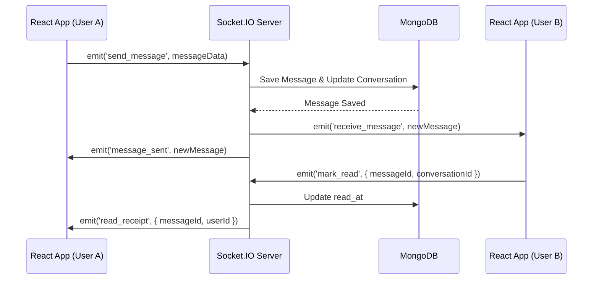

# Phase 3: Social Feed & Communication (Weeks 7-9)

This phase focuses on building a B2B social feed, real-time messaging, meeting requests, and a robust notification system.

## 3.1 Social Feed - Posts System

The social feed allows companies to broadcast updates, product launches, case studies, and more to their followers.

### Data Models (Mongoose Schemas)

```javascript
// models/Post.js
const mongoose = require('mongoose');

const postSchema = new mongoose.Schema({
  company_id: { type: mongoose.Schema.Types.ObjectId, ref: 'Company', required: true, index: true },
  author_id: { type: mongoose.Schema.Types.ObjectId, ref: 'User', required: true },
  post_type: { 
    type: String, 
    enum: ['product_launch', 'demonstration', 'announcement', 'offer', 'case_study', 'event', 'technical'],
    required: true
  },
  title: { type: String },
  content: { type: String, required: true },
  tags: [{ type: String }],
  media: [{
    type: { type: String, enum: ['image', 'video', 'document'] },
    url: { type: String, required: true },
    thumbnail_url: { type: String }
  }],
  like_count: { type: Number, default: 0 },
  comment_count: { type: Number, default: 0 },
  view_count: { type: Number, default: 0 },
  share_count: { type: Number, default: 0 },
  status: { type: String, enum: ['draft', 'published', 'archived'], default: 'published' },
  published_at: { type: Date, default: Date.now, index: true },
  expires_at: { type: Date } // Useful for offers
}, { timestamps: true });

// models/PostLike.js
const postLikeSchema = new mongoose.Schema({
  post_id: { type: mongoose.Schema.Types.ObjectId, ref: 'Post', required: true },
  user_id: { type: mongoose.Schema.Types.ObjectId, ref: 'User', required: true }
}, { timestamps: true });
postLikeSchema.index({ post_id: 1, user_id: 1 }, { unique: true });

// models/PostComment.js
const postCommentSchema = new mongoose.Schema({
  post_id: { type: mongoose.Schema.Types.ObjectId, ref: 'Post', required: true },
  user_id: { type: mongoose.Schema.Types.ObjectId, ref: 'User', required: true },
  parent_comment_id: { type: mongoose.Schema.Types.ObjectId, ref: 'PostComment', default: null }, // For threading
  content: { type: String, required: true },
  is_deleted: { type: Boolean, default: false }
}, { timestamps: true });

// models/Follow.js
const followSchema = new mongoose.Schema({
  follower_user_id: { type: mongoose.Schema.Types.ObjectId, ref: 'User' },
  follower_company_id: { type: mongoose.Schema.Types.ObjectId, ref: 'Company' },
  following_company_id: { type: mongoose.Schema.Types.ObjectId, ref: 'Company', required: true }
}, { timestamps: true });
// Ensure either user or company is the follower
```

### APIs

- `POST /api/posts` — Create a post with media links.
- `GET /api/feed` — Personalized feed from followed companies. Cursor paginated (using `published_at` as cursor).
- `GET /api/feed/discover` — Public discovery feed showing trending/recent posts (no auth required).
- `POST /api/posts/:id/like` — Like a post.
- `DELETE /api/posts/:id/like` — Unlike a post.
- `GET /api/posts/:id/comments` — Fetch threaded comments.
- `POST /api/posts/:id/comments` — Add a comment.
- `POST /api/posts/:id/media` — Presigned URL generation or media attachment endpoint.

### React Component Structure

- `PostCard`: Displays post content. Includes image carousel, like/comment/save actions, and company header.
- `PostEditor`: Rich text editor, media upload drag-and-drop, type selector, tag inputs.
- `FeedPage`: Infinite scroll utilizing TanStack Query `useInfiniteQuery`.
- `DiscoverPage`: Discovery view for non-authenticated or exploring users.

### Feed Visibility Score Job

Nightly node-cron job to recalculate `feed_visibility_score` for companies.
```javascript
// Formula snippet
const score = (posts_last_30_days * 0.4) + (avg_engagement * 0.3) + (profile_completeness * 0.2) + (response_rate * 0.1);
```

## 3.2 Direct Messaging

Real-time B2B communication.

### Socket.IO Integration Pattern



### APIs
- `GET /api/conversations` — List conversations.
- `GET /api/conversations/:id/messages` — Load message history.
- `POST /api/conversations/:id/messages` — Fallback for HTTP message sending.

### React Integration
- `ConversationList`: Sidebar with active chats.
- `ChatWindow`: Main area, handles auto-scroll, real-time appends.
- `MessageBubble`: Standard text display.
- `ProductCardMessage`: Specialized bubble for shared products.

## 3.3 Meeting Request System

Structured workflow for B2B meeting coordination.

### Data Models

```javascript
// models/MeetingRequest.js
const meetingRequestSchema = new mongoose.Schema({
  requester_id: { type: mongoose.Schema.Types.ObjectId, ref: 'User' },
  requester_company_id: { type: mongoose.Schema.Types.ObjectId, ref: 'Company' },
  recipient_company_id: { type: mongoose.Schema.Types.ObjectId, ref: 'Company' },
  recipient_contact_id: { type: mongoose.Schema.Types.ObjectId, ref: 'User' },
  product_id: { type: mongoose.Schema.Types.ObjectId, ref: 'Product' },
  title: String,
  purpose: String,
  proposed_slots: [{
    date: Date,
    start_time: String,
    end_time: String
  }],
  duration_minutes: Number,
  mode: { type: String, enum: ['in_person', 'video', 'phone'] },
  location: String,
  agenda: String,
  notes: String,
  status: { 
    type: String, 
    enum: ['pending', 'accepted', 'alternative_proposed', 'declined', 'cancelled', 'completed', 'no_show']
  },
  status_history: [{ status: String, changed_at: Date, changed_by: mongoose.Schema.Types.ObjectId }],
  decline_reason: String,
  outcome: String,
  outcome_tags: [String]
});
```

### APIs
- `POST /api/meeting-requests`
- `PATCH /api/meeting-requests/:id/respond` (accept, decline, counter-propose)
- `GET /api/meetings`
- `PATCH /api/meetings/:id/complete`
- `PATCH /api/meetings/:id/cancel`

### React Components
- `MeetingRequestForm`: Multi-step form for proposing times and agenda.
- `MeetingInbox`: Dashboard for incoming/outgoing requests.
- `MeetingCalendar`: Visual calendar view.
- `MeetingDetail`: Specifics of a request/meeting.

## 3.4 Notification System

### Data Model
```javascript
// models/Notification.js
const notificationSchema = new mongoose.Schema({
  user_id: { type: mongoose.Schema.Types.ObjectId, ref: 'User', index: true },
  type: { 
    type: String, 
    enum: ['new_message', 'meeting_request', 'meeting_accepted', 'meeting_declined', 'new_follower', 'post_like', 'post_comment', 'lead_assigned'] 
  },
  title: String,
  body: String,
  data: { type: mongoose.Schema.Types.Mixed }, // JSONB-like
  is_read: { type: Boolean, default: false }
}, { timestamps: true });
```

## 3.5 Week-by-Week Breakdown

- **Week 7**: Post system, feed pages, infinite scroll, likes/comments.
- **Week 8**: Messaging with Socket.IO, conversation UI, product cards in messages.
- **Week 9**: Meeting request workflow, calendar, notifications, feed_visibility_score job.
