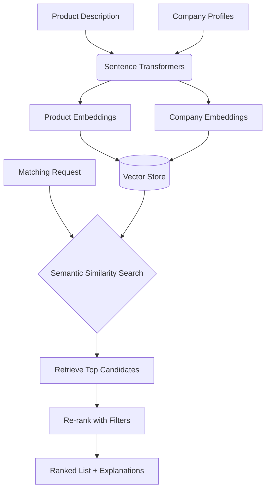
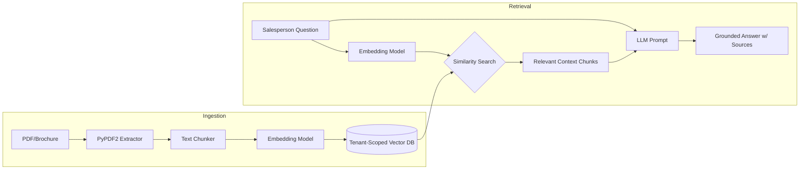

# Phase 4: AI-Powered Sales Intelligence (Weeks 10-13)

This phase introduces AI capabilities using a dedicated Python microservice to handle LLM interactions, RAG, and vector embeddings.

## 4.1 AI Service Architecture

The system utilizes a dual-backend architecture. The existing Express backend acts as the main API gateway, forwarding AI requests to a separate Python FastAPI service.

### Folder Structure
```
ai-service/
├── app/
│   ├── main.py              # FastAPI app setup and routing
│   ├── api/
│   │   ├── icp.py           # ICP generation endpoints
│   │   ├── matching.py      # Product-to-business matching endpoints
│   │   ├── scoring.py       # Lead scoring endpoint
│   │   ├── research.py      # Market research generation
│   │   ├── outreach.py      # Pitch/outreach generation
│   │   └── rag.py           # RAG over company docs
│   ├── services/
│   │   ├── llm.py           # LLM client wrapper (OpenAI/Gemini)
│   │   ├── embeddings.py    # Embedding generation (sentence-transformers)
│   │   ├── vector_store.py  # FAISS or MongoDB Atlas Vector Search integration
│   │   └── retriever.py     # RAG retriever logic
│   ├── models/
│   │   ├── schemas.py       # Pydantic models for request/response validation
│   │   └── prompts.py       # Prompt templates for different AI tasks
│   └── config.py            # Environment variables and settings
├── requirements.txt
├── Dockerfile
└── tests/
```

## 4.2 AI Market Research Assistant

- **Input**: Product name, category, specs, target industries, target city, pricing, constraints.
- **Process**: LLM integrates with web search tools or RAG over pre-ingested market data.
- **Output**: Structured JSON report translated into UI components. Includes: Market overview, Customer segments, Common needs, Competitor landscape, Geographic clusters, Regulatory notes.
- **API**: `POST /api/ai/research`
- **React**: `MarketResearchWizard` for input, `ResearchReport` for output visualization.

## 4.3 ICP (Ideal Customer Profile) Generator

- **Process**: Uses LLM to transform product details and rough target market preferences into a highly structured JSON ICP.
- **Output**: Industry fit, company size range, geography, typical roles, pain points, buying signals, disqualifiers. Editable by the user before saving.
- **API**: `POST /api/ai/icp`

## 4.4 Product-to-Business Matching (Embeddings)

Matches products to potential buyer companies using semantic similarity.



- **Process**: Uses `sentence-transformers` (`all-MiniLM-L6-v2`) to generate embeddings. Stores in FAISS or MongoDB Atlas Vector Search.
- **API**: `POST /api/ai/match`

## 4.5 AI Lead Scoring

Transparent weighted model to score leads.

- **Model Weights**:
  - Product relevance: 30%
  - Verified need: 25%
  - Budget fit: 15%
  - Decision-maker identified: 10%
  - Purchase timeline: 10%
  - Location/service fit: 10%
- **Output**: Overall score, factor breakdown, and missing data flags.
- **API**: `POST /api/ai/score`

## 4.6 AI Outreach & Pitch Generator

- **Process**: Generates highly personalized draft messages combining the salesperson's product, prospect profile, purpose, and desired tone. Requires human review.
- **API**: `POST /api/ai/outreach-draft`

## 4.7 RAG over Company Documents

Allows natural language querying of company materials (e.g., brochures, technical specs).



- **API**: `POST /api/ai/ask`

## 4.8 Meeting Notes Summarizer

- **Process**: Structures free-text meeting notes into Needs, Objections, Stakeholders, Next steps, and Follow-up date.
- **API**: `POST /api/ai/summarize-notes`

## 4.9 Integration Points

- **Map view**: Show AI match score badges on map markers.
- **Company profile**: "AI Insights" tab.
- **Lead detail**: AI-generated score + match explanation.
- **Meeting prep**: AI-generated talking points.
- **Post-meeting**: AI note summarizer.

## 4.10 Week-by-Week Breakdown

- **Week 10**: Set up Python FastAPI service, LLM integration, ICP generator.
- **Week 11**: Embedding pipeline, product-to-business matching, vector store.
- **Week 12**: Lead scoring, outreach generator, RAG pipeline.
- **Week 13**: Meeting assistant, integration with frontend, testing AI quality.
