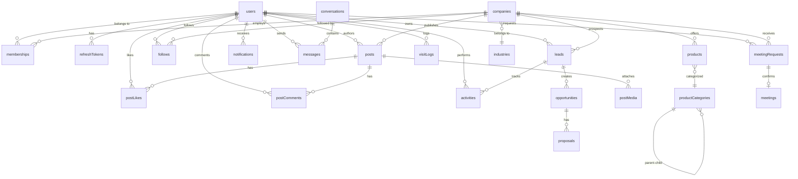

# Complete MongoDB Schema Reference

> All collections use Mongoose with `timestamps: true` (auto `createdAt` / `updatedAt`).
> ObjectId references use `mongoose.Schema.Types.ObjectId` (aliased as `ObjectId` below).

---

## Entity Relationship Diagram



---

## 1. users

```javascript
const UserSchema = new mongoose.Schema({
  email:          { type: String, required: true, unique: true, lowercase: true, trim: true },
  password_hash:  { type: String, required: true, select: false },
  full_name:      { type: String, required: true, trim: true },
  phone:          { type: String, trim: true },
  avatar_url:     { type: String },
  role: {
    type: String,
    enum: ['salesperson', 'company_member', 'company_admin', 'platform_admin'],
    required: true
  },
  company_id:     { type: ObjectId, ref: 'Company', default: null },
  preferences: {
    language:        { type: String, default: 'en' },
    notification_email: { type: Boolean, default: true },
    notification_push:  { type: Boolean, default: true },
    default_radius_km:  { type: Number, default: 10 },
    preferred_industries: [{ type: ObjectId, ref: 'Industry' }]
  },
  status:         { type: String, enum: ['active', 'suspended', 'deactivated'], default: 'active' },
  email_verified: { type: Boolean, default: false },
  email_verify_token: { type: String, select: false },
  password_reset_token: { type: String, select: false },
  password_reset_expires: { type: Date, select: false },
  last_login_at:  { type: Date }
}, { timestamps: true });

// Indexes
UserSchema.index({ email: 1 }, { unique: true });
UserSchema.index({ company_id: 1 });
UserSchema.index({ role: 1 });
UserSchema.index({ full_name: 'text' });
```

**Example Document:**
```json
{
  "_id": "665a1b2c3d4e5f6a7b8c9d0e",
  "email": "rahul.sharma@techcorp.in",
  "full_name": "Rahul Sharma",
  "phone": "+919876543210",
  "avatar_url": "/uploads/avatars/rahul.jpg",
  "role": "salesperson",
  "company_id": "665a1b2c3d4e5f6a7b8c9d01",
  "preferences": { "language": "en", "default_radius_km": 15 },
  "status": "active",
  "email_verified": true,
  "last_login_at": "2026-09-28T10:30:00Z"
}
```

---

## 2. refreshTokens

```javascript
const RefreshTokenSchema = new mongoose.Schema({
  token_hash: { type: String, required: true, unique: true },
  user_id:    { type: ObjectId, ref: 'User', required: true },
  user_agent: { type: String },
  ip_address: { type: String },
  expires_at: { type: Date, required: true },
  revoked_at: { type: Date, default: null }
}, { timestamps: true });

// Indexes
RefreshTokenSchema.index({ token_hash: 1 }, { unique: true });
RefreshTokenSchema.index({ user_id: 1 });
RefreshTokenSchema.index({ expires_at: 1 }, { expireAfterSeconds: 0 }); // TTL auto-delete
```

---

## 3. companies

```javascript
const CompanySchema = new mongoose.Schema({
  name:            { type: String, required: true, trim: true },
  slug:            { type: String, unique: true, lowercase: true },
  description:     { type: String, maxlength: 2000 },
  logo_url:        { type: String },
  cover_image_url: { type: String },
  industry:        { type: ObjectId, ref: 'Industry' },
  business_category: { type: String }, // e.g. "Manufacturer", "Distributor", "Retailer"
  employee_range:  { type: String, enum: ['1-10', '11-50', '51-200', '201-500', '500+'] },
  gstin:           { type: String, trim: true },
  website:         { type: String },
  email:           { type: String, lowercase: true },
  phone:           { type: String },

  // Primary address with GeoJSON
  address: {
    street:  { type: String },
    city:    { type: String },
    state:   { type: String },
    pincode: { type: String },
    country: { type: String, default: 'India' },
    location: {
      type:        { type: String, enum: ['Point'], default: 'Point' },
      coordinates: { type: [Number] } // [longitude, latitude]
    }
  },

  // Additional office/warehouse locations
  operating_locations: [{
    label: String, // "Warehouse", "Branch Office"
    city: String,
    state: String,
    location: {
      type:        { type: String, enum: ['Point'], default: 'Point' },
      coordinates: { type: [Number] }
    }
  }],

  verification_status: {
    type: String,
    enum: ['unsubmitted', 'pending', 'verified', 'rejected', 'expired'],
    default: 'unsubmitted'
  },
  verification_documents: [{
    name: String,
    url:  String,
    uploaded_at: Date
  }],
  verified_at: { type: Date },

  feed_visibility_score: { type: Number, default: 0, min: 0, max: 100 },
  target_markets: [{ type: String }], // city names or region codes

  settings: {
    allow_meeting_requests: { type: Boolean, default: true },
    public_email:           { type: Boolean, default: false },
    public_phone:           { type: Boolean, default: false },
    auto_accept_meetings:   { type: Boolean, default: false }
  },

  follower_count:  { type: Number, default: 0 },
  product_count:   { type: Number, default: 0 },
  post_count:      { type: Number, default: 0 },
  profile_views:   { type: Number, default: 0 }
}, { timestamps: true });

// Indexes
CompanySchema.index({ slug: 1 }, { unique: true });
CompanySchema.index({ 'address.location': '2dsphere' });           // Geospatial
CompanySchema.index({ 'operating_locations.location': '2dsphere' });
CompanySchema.index({ industry: 1 });
CompanySchema.index({ verification_status: 1 });
CompanySchema.index({ feed_visibility_score: -1 });
CompanySchema.index({ name: 'text', description: 'text' });       // Full-text search
```

**Example Document:**
```json
{
  "_id": "665a1b2c3d4e5f6a7b8c9d01",
  "name": "TechCorp Industries Pvt. Ltd.",
  "slug": "techcorp-industries",
  "description": "Leading manufacturer of industrial filtration systems...",
  "industry": "665aINDUSTRY001",
  "business_category": "Manufacturer",
  "employee_range": "201-500",
  "gstin": "27AABCT1234F1ZP",
  "address": {
    "city": "Pune", "state": "Maharashtra", "pincode": "411001",
    "location": { "type": "Point", "coordinates": [73.8567, 18.5204] }
  },
  "verification_status": "verified",
  "feed_visibility_score": 72,
  "follower_count": 145,
  "product_count": 23
}
```

---

## 4. memberships

```javascript
const MembershipSchema = new mongoose.Schema({
  user_id:    { type: ObjectId, ref: 'User', required: true },
  company_id: { type: ObjectId, ref: 'Company', required: true },
  role:       { type: String, enum: ['owner', 'admin', 'member', 'salesperson'], required: true },
  status:     { type: String, enum: ['invited', 'active', 'suspended', 'removed'], default: 'invited' },
  territory:  [{ type: String }], // assigned city names
  invited_by: { type: ObjectId, ref: 'User' },
  joined_at:  { type: Date }
}, { timestamps: true });

MembershipSchema.index({ user_id: 1, company_id: 1 }, { unique: true });
MembershipSchema.index({ company_id: 1, status: 1 });
```

---

## 5. industries

```javascript
const IndustrySchema = new mongoose.Schema({
  name:        { type: String, required: true, unique: true },
  slug:        { type: String, required: true, unique: true },
  icon:        { type: String }, // FontAwesome class or emoji
  description: { type: String },
  is_active:   { type: Boolean, default: true },
  sort_order:  { type: Number, default: 0 }
}, { timestamps: true });

IndustrySchema.index({ slug: 1 }, { unique: true });
IndustrySchema.index({ is_active: 1 });
```

**Seed Data:** Manufacturing, FMCG, Pharma, IT/Software, Healthcare, Agriculture, Construction, Textiles, Automotive, Electronics, Food & Beverage, Chemicals, Logistics, Education, Energy, Mining, Real Estate, Retail, Telecom, Financial Services.

---

## 6. productCategories

```javascript
const ProductCategorySchema = new mongoose.Schema({
  name:      { type: String, required: true },
  slug:      { type: String, required: true, unique: true },
  parent_id: { type: ObjectId, ref: 'ProductCategory', default: null }, // Self-reference for hierarchy
  level:     { type: Number, default: 0 }, // 0 = root, 1 = child, 2 = grandchild
  icon:      { type: String },
  is_active: { type: Boolean, default: true }
}, { timestamps: true });

ProductCategorySchema.index({ slug: 1 }, { unique: true });
ProductCategorySchema.index({ parent_id: 1 });
```

---

## 7. products

```javascript
const ProductSchema = new mongoose.Schema({
  company_id:  { type: ObjectId, ref: 'Company', required: true },
  name:        { type: String, required: true, trim: true },
  category_id: { type: ObjectId, ref: 'ProductCategory' },
  description: { type: String, maxlength: 5000 },
  specifications: [{
    key:   { type: String }, // e.g. "Weight", "Power", "Capacity"
    value: { type: String },
    unit:  { type: String }
  }],
  images: [{
    url:           { type: String, required: true },
    thumbnail_url: { type: String },
    alt:           { type: String },
    sort_order:    { type: Number, default: 0 }
  }],
  video_url: { type: String },
  variants: [{
    name:  { type: String },
    sku:   { type: String },
    price: { type: Number }
  }],
  price_min:       { type: Number },
  price_max:       { type: Number },
  pricing_visible: { type: Boolean, default: true },
  unit:            { type: String, default: 'piece' }, // "piece", "kg", "litre", "box"
  min_order_qty:   { type: Number, default: 1 },
  availability:    { type: String, enum: ['in_stock', 'made_to_order', 'out_of_stock'], default: 'in_stock' },
  service_coverage: [{ type: String }], // city names
  warranty:        { type: String },
  documents: [{
    name: { type: String },
    url:  { type: String },
    type: { type: String, enum: ['brochure', 'datasheet', 'certificate', 'catalogue'] }
  }],
  sku:    { type: String },
  status: { type: String, enum: ['active', 'draft', 'archived'], default: 'active' },

  // Denormalized counters
  inquiry_count: { type: Number, default: 0 },
  view_count:    { type: Number, default: 0 }
}, { timestamps: true });

ProductSchema.index({ company_id: 1, status: 1 });
ProductSchema.index({ category_id: 1 });
ProductSchema.index({ name: 'text', description: 'text' });
ProductSchema.index({ price_min: 1, price_max: 1 });
```

**Example Document:**
```json
{
  "_id": "665aPROD001",
  "company_id": "665a1b2c3d4e5f6a7b8c9d01",
  "name": "Industrial Water Filtration System - Pro 5000",
  "category_id": "665aCATfilter",
  "description": "High-capacity water filtration for industrial use...",
  "specifications": [
    { "key": "Capacity", "value": "5000", "unit": "litres/hour" },
    { "key": "Power", "value": "2.5", "unit": "kW" }
  ],
  "images": [{ "url": "/uploads/products/wfs-1.jpg", "thumbnail_url": "/uploads/products/wfs-1-thumb.jpg" }],
  "price_min": 150000, "price_max": 250000,
  "unit": "piece", "min_order_qty": 1,
  "availability": "made_to_order",
  "status": "active"
}
```

---

## 8. posts

```javascript
const PostSchema = new mongoose.Schema({
  company_id: { type: ObjectId, ref: 'Company', required: true },
  author_id:  { type: ObjectId, ref: 'User', required: true },
  post_type: {
    type: String,
    enum: ['product_launch', 'demonstration', 'announcement', 'offer', 'case_study', 'event', 'technical'],
    required: true
  },
  title:   { type: String, required: true, trim: true },
  content: { type: String, maxlength: 10000 },
  tags:    [{ type: String, lowercase: true }],
  media: [{
    type:          { type: String, enum: ['image', 'video', 'pdf', 'link'] },
    url:           { type: String },
    thumbnail_url: { type: String },
    alt:           { type: String }
  }],
  product_id: { type: ObjectId, ref: 'Product', default: null }, // Optional product reference

  // Denormalized counters
  like_count:    { type: Number, default: 0 },
  comment_count: { type: Number, default: 0 },
  view_count:    { type: Number, default: 0 },
  share_count:   { type: Number, default: 0 },

  status: { type: String, enum: ['draft', 'published', 'archived'], default: 'draft' },
  published_at: { type: Date },
  expires_at:   { type: Date } // for time-limited offers
}, { timestamps: true });

PostSchema.index({ company_id: 1, status: 1, published_at: -1 });
PostSchema.index({ author_id: 1 });
PostSchema.index({ tags: 1 });
PostSchema.index({ post_type: 1 });
PostSchema.index({ title: 'text', content: 'text', tags: 'text' });
```

---

## 9. postLikes

```javascript
const PostLikeSchema = new mongoose.Schema({
  post_id: { type: ObjectId, ref: 'Post', required: true },
  user_id: { type: ObjectId, ref: 'User', required: true }
}, { timestamps: true });

PostLikeSchema.index({ post_id: 1, user_id: 1 }, { unique: true }); // One like per user per post
PostLikeSchema.index({ user_id: 1 });
```

---

## 10. postComments

```javascript
const PostCommentSchema = new mongoose.Schema({
  post_id:           { type: ObjectId, ref: 'Post', required: true },
  author_id:         { type: ObjectId, ref: 'User', required: true },
  content:           { type: String, required: true, maxlength: 2000 },
  parent_comment_id: { type: ObjectId, ref: 'PostComment', default: null }, // Threading
  is_deleted:        { type: Boolean, default: false },
  like_count:        { type: Number, default: 0 }
}, { timestamps: true });

PostCommentSchema.index({ post_id: 1, createdAt: -1 });
PostCommentSchema.index({ parent_comment_id: 1 });
```

---

## 11. follows

```javascript
const FollowSchema = new mongoose.Schema({
  follower_user_id:    { type: ObjectId, ref: 'User', default: null },
  follower_company_id: { type: ObjectId, ref: 'Company', default: null },
  following_company_id: { type: ObjectId, ref: 'Company', required: true }
}, { timestamps: true });

// At least one of follower_user_id or follower_company_id must be set
FollowSchema.index({ follower_user_id: 1, following_company_id: 1 }, { unique: true, sparse: true });
FollowSchema.index({ follower_company_id: 1, following_company_id: 1 }, { unique: true, sparse: true });
FollowSchema.index({ following_company_id: 1 });
```

---

## 12. conversations

```javascript
const ConversationSchema = new mongoose.Schema({
  participants:  [{ type: ObjectId, ref: 'User' }],
  company_scope: { type: ObjectId, ref: 'Company', default: null }, // Optional: ties conversation to a company context
  product_scope: { type: ObjectId, ref: 'Product', default: null }, // Optional: product inquiry context
  last_message_preview: { type: String },
  last_message_at:      { type: Date },
  unread_counts: { type: Map, of: Number, default: {} }, // { "userId": count }
  status: { type: String, enum: ['active', 'archived', 'blocked'], default: 'active' }
}, { timestamps: true });

ConversationSchema.index({ participants: 1 });
ConversationSchema.index({ last_message_at: -1 });
```

---

## 13. messages

```javascript
const MessageSchema = new mongoose.Schema({
  conversation_id: { type: ObjectId, ref: 'Conversation', required: true },
  sender_id:       { type: ObjectId, ref: 'User', required: true },
  content:         { type: String, maxlength: 5000 },
  message_type: {
    type: String,
    enum: ['text', 'product_card', 'meeting_invite', 'file', 'system'],
    default: 'text'
  },
  attachments: [{
    name:      { type: String },
    url:       { type: String },
    file_type: { type: String },
    size:      { type: Number }
  }],
  product_ref:  { type: ObjectId, ref: 'Product', default: null },  // For product_card type
  meeting_ref:  { type: ObjectId, ref: 'MeetingRequest', default: null }, // For meeting_invite type
  read_by:      [{ user_id: ObjectId, read_at: Date }],
  delivered_at: { type: Date },
  is_deleted:   { type: Boolean, default: false }
}, { timestamps: true });

MessageSchema.index({ conversation_id: 1, createdAt: -1 });
MessageSchema.index({ sender_id: 1 });
```

---

## 14. meetingRequests

```javascript
const MeetingRequestSchema = new mongoose.Schema({
  requester_id:         { type: ObjectId, ref: 'User', required: true },
  requester_company_id: { type: ObjectId, ref: 'Company' },
  recipient_company_id: { type: ObjectId, ref: 'Company', required: true },
  recipient_contact_id: { type: ObjectId, ref: 'User' }, // Specific person if known
  product_id:           { type: ObjectId, ref: 'Product' },
  title:                { type: String, required: true },
  purpose:              { type: String },
  proposed_slots: [{
    date:       { type: Date },
    start_time: { type: String }, // "10:00"
    end_time:   { type: String }  // "11:00"
  }],
  duration_minutes: { type: Number, default: 60 },
  mode:     { type: String, enum: ['in_person', 'video', 'phone'], default: 'in_person' },
  location: { type: String },
  agenda:   { type: String },
  notes:    { type: String },
  status: {
    type: String,
    enum: ['pending', 'accepted', 'alternative_proposed', 'declined', 'cancelled', 'completed', 'no_show'],
    default: 'pending'
  },
  status_history: [{
    status:     String,
    changed_by: { type: ObjectId, ref: 'User' },
    reason:     String,
    changed_at: { type: Date, default: Date.now }
  }],
  decline_reason:   { type: String },
  outcome:          { type: String },
  outcome_tags:     [{ type: String }] // "interested", "needs_followup", "not_relevant"
}, { timestamps: true });

MeetingRequestSchema.index({ requester_id: 1, status: 1 });
MeetingRequestSchema.index({ recipient_company_id: 1, status: 1 });
MeetingRequestSchema.index({ 'proposed_slots.date': 1 });
```

---

## 15. meetings (confirmed)

```javascript
const MeetingSchema = new mongoose.Schema({
  meeting_request_id: { type: ObjectId, ref: 'MeetingRequest', required: true },
  confirmed_time:     { type: Date, required: true },
  confirmed_location: { type: String },
  mode:               { type: String, enum: ['in_person', 'video', 'phone'] },
  attendees: [{
    user_id: { type: ObjectId, ref: 'User' },
    role:    { type: String, enum: ['host', 'guest', 'observer'] },
    status:  { type: String, enum: ['confirmed', 'tentative', 'declined'], default: 'confirmed' }
  }],
  reminder_sent: { type: Boolean, default: false },
  completed_at:  { type: Date },
  outcome:       { type: String },
  notes:         { type: String },
  ai_summary:    { type: String } // AI-generated meeting summary
}, { timestamps: true });

MeetingSchema.index({ confirmed_time: 1 });
MeetingSchema.index({ 'attendees.user_id': 1 });
```

---

## 16. leads

```javascript
const LeadSchema = new mongoose.Schema({
  owner_company_id:   { type: ObjectId, ref: 'Company', required: true },
  prospect_company_id: { type: ObjectId, ref: 'Company' },
  prospect_contact: {
    name:  { type: String },
    email: { type: String },
    phone: { type: String },
    role:  { type: String }
  },
  source: {
    type: String,
    enum: ['map_discovery', 'feed', 'ai_recommendation', 'referral', 'import', 'manual', 'inquiry'],
    required: true
  },
  owner_id:         { type: ObjectId, ref: 'User', required: true }, // Assigned salesperson
  product_interest: [{ type: ObjectId, ref: 'Product' }],
  qualification: {
    budget:    { score: Number, notes: String, status: { type: String, enum: ['unknown', 'qualified', 'disqualified'] } },
    authority: { score: Number, notes: String, status: { type: String, enum: ['unknown', 'qualified', 'disqualified'] } },
    need:      { score: Number, notes: String, status: { type: String, enum: ['unknown', 'qualified', 'disqualified'] } },
    timeline:  { score: Number, notes: String, status: { type: String, enum: ['unknown', 'qualified', 'disqualified'] } }
  },
  stage: {
    type: String,
    enum: ['new', 'qualified', 'contacted', 'meeting', 'proposal', 'negotiation', 'won', 'lost', 'nurture'],
    default: 'new'
  },
  estimated_value:    { type: Number },
  expected_close_date: { type: Date },
  loss_reason:        { type: String },
  tags:               [{ type: String }],
  ai_match_score:     { type: Number }, // 0-100
  ai_match_explanation: { type: String },
  activity_count:     { type: Number, default: 0 },
  last_activity_at:   { type: Date },
  next_followup_at:   { type: Date }
}, { timestamps: true });

LeadSchema.index({ owner_company_id: 1, stage: 1 });
LeadSchema.index({ owner_id: 1, stage: 1 });
LeadSchema.index({ prospect_company_id: 1 });
LeadSchema.index({ next_followup_at: 1 }); // For overdue queries
LeadSchema.index({ source: 1 });
```

**Example Document:**
```json
{
  "_id": "665aLEAD001",
  "owner_company_id": "665aCOMP01",
  "prospect_company_id": "665aCOMP42",
  "source": "ai_recommendation",
  "owner_id": "665aUSER_rahul",
  "product_interest": ["665aPROD001"],
  "qualification": {
    "budget": { "score": 8, "notes": "Annual procurement budget ~20L", "status": "qualified" },
    "authority": { "score": 5, "notes": "Need to reach plant manager", "status": "unknown" },
    "need": { "score": 9, "notes": "Current system is 10+ years old", "status": "qualified" },
    "timeline": { "score": 7, "notes": "Q1 next year replacement planned", "status": "qualified" }
  },
  "stage": "meeting",
  "estimated_value": 450000,
  "ai_match_score": 85,
  "next_followup_at": "2026-10-05T09:00:00Z"
}
```

---

## 17. opportunities

```javascript
const OpportunitySchema = new mongoose.Schema({
  lead_id:    { type: ObjectId, ref: 'Lead', required: true },
  product_id: { type: ObjectId, ref: 'Product' },
  value:      { type: Number },
  stage: {
    type: String,
    enum: ['proposal', 'negotiation', 'won', 'lost'],
    default: 'proposal'
  },
  expected_close_date: { type: Date },
  proposal_versions:   [{ type: ObjectId, ref: 'Proposal' }],
  negotiation_notes:   { type: String },
  outcome:    { type: String },
  won_date:   { type: Date },
  lost_date:  { type: Date },
  lost_reason: { type: String }
}, { timestamps: true });

OpportunitySchema.index({ lead_id: 1 });
OpportunitySchema.index({ stage: 1 });
```

---

## 18. activities

```javascript
const ActivitySchema = new mongoose.Schema({
  related_to: {
    type:  { type: String, enum: ['lead', 'opportunity', 'company'] },
    ref_id: { type: ObjectId }
  },
  activity_type: {
    type: String,
    enum: ['call', 'email', 'meeting', 'note', 'task', 'visit', 'follow_up'],
    required: true
  },
  owner_id:    { type: ObjectId, ref: 'User', required: true },
  title:       { type: String, required: true },
  description: { type: String },
  due_date:    { type: Date },
  completed_at: { type: Date },
  outcome:     { type: String },
  is_overdue:  { type: Boolean, default: false }
}, { timestamps: true });

ActivitySchema.index({ 'related_to.ref_id': 1, 'related_to.type': 1 });
ActivitySchema.index({ owner_id: 1, due_date: 1 });
ActivitySchema.index({ is_overdue: 1 });
```

---

## 19. proposals

```javascript
const ProposalSchema = new mongoose.Schema({
  opportunity_id: { type: ObjectId, ref: 'Opportunity', required: true },
  company_id:     { type: ObjectId, ref: 'Company', required: true },
  version:        { type: Number, default: 1 },
  line_items: [{
    product_id: { type: ObjectId, ref: 'Product' },
    name:       String,
    quantity:   Number,
    unit_price: Number,
    discount_percent: { type: Number, default: 0 },
    subtotal:   Number
  }],
  taxes:           { type: Number, default: 0 },
  delivery_charges: { type: Number, default: 0 },
  total_amount:    { type: Number },
  payment_terms:   { type: String },
  warranty:        { type: String },
  validity_period: { type: Number, default: 30 }, // days
  notes:           { type: String },
  status: {
    type: String,
    enum: ['draft', 'sent', 'accepted', 'rejected', 'expired'],
    default: 'draft'
  },
  sent_at:      { type: Date },
  responded_at: { type: Date }
}, { timestamps: true });

ProposalSchema.index({ opportunity_id: 1 });
ProposalSchema.index({ company_id: 1, status: 1 });
```

---

## 20. notifications

```javascript
const NotificationSchema = new mongoose.Schema({
  user_id: { type: ObjectId, ref: 'User', required: true },
  type: {
    type: String,
    enum: [
      'new_message', 'meeting_request', 'meeting_accepted', 'meeting_declined',
      'meeting_reminder', 'new_follower', 'post_like', 'post_comment',
      'lead_assigned', 'proposal_response', 'system'
    ],
    required: true
  },
  title: { type: String, required: true },
  body:  { type: String },
  data:  { type: mongoose.Schema.Types.Mixed }, // Flexible payload: { meetingId, postId, etc. }
  is_read: { type: Boolean, default: false },
  link:    { type: String } // Frontend route to navigate to
}, { timestamps: true });

NotificationSchema.index({ user_id: 1, is_read: 1, createdAt: -1 });
```

---

## 21. visitLogs

```javascript
const VisitLogSchema = new mongoose.Schema({
  user_id:    { type: ObjectId, ref: 'User', required: true },
  company_id: { type: ObjectId, ref: 'Company', required: true },
  visit_type: {
    type: String,
    enum: ['profile_view', 'map_pin_tap', 'product_view', 'meeting_completed'],
    required: true
  },
  metadata: { type: mongoose.Schema.Types.Mixed } // { product_id, source: "map"|"feed"|"search" }
}, { timestamps: true });

VisitLogSchema.index({ company_id: 1, visit_type: 1 });
VisitLogSchema.index({ user_id: 1, createdAt: -1 });
```

---

## 22. aiReports

```javascript
const AIReportSchema = new mongoose.Schema({
  company_id:   { type: ObjectId, ref: 'Company' },
  user_id:      { type: ObjectId, ref: 'User', required: true },
  report_type: {
    type: String,
    enum: ['market_research', 'icp', 'product_match', 'lead_score', 'outreach_draft', 'meeting_summary', 'rag_query'],
    required: true
  },
  input:         { type: mongoose.Schema.Types.Mixed }, // Original request parameters
  output:        { type: mongoose.Schema.Types.Mixed }, // AI response
  model_version: { type: String }, // e.g. "gpt-4o-2024-05-13"
  prompt_version: { type: String }, // Version of the prompt template used
  tokens_used:   { input: Number, output: Number },
  latency_ms:    { type: Number },
  quality_rating: { type: Number, min: 1, max: 5 } // Optional user feedback
}, { timestamps: true });

AIReportSchema.index({ company_id: 1, report_type: 1, createdAt: -1 });
AIReportSchema.index({ user_id: 1 });
```

---

## Key Index Summary

| Collection | Index Type | Fields | Purpose |
|---|---|---|---|
| companies | 2dsphere | `address.location` | Geospatial nearby queries |
| companies | text | `name, description` | Full-text search |
| companies | single | `feed_visibility_score` (desc) | Ranking sort |
| products | text | `name, description` | Product search |
| posts | compound | `company_id, status, published_at` | Feed queries |
| postLikes | unique compound | `post_id, user_id` | One like per user |
| leads | compound | `owner_id, stage` | Pipeline queries |
| leads | single | `next_followup_at` | Overdue follow-up queries |
| meetingRequests | compound | `recipient_company_id, status` | Inbox queries |
| conversations | single | `last_message_at` (desc) | Conversation ordering |
| notifications | compound | `user_id, is_read, createdAt` | Unread notification fetch |
