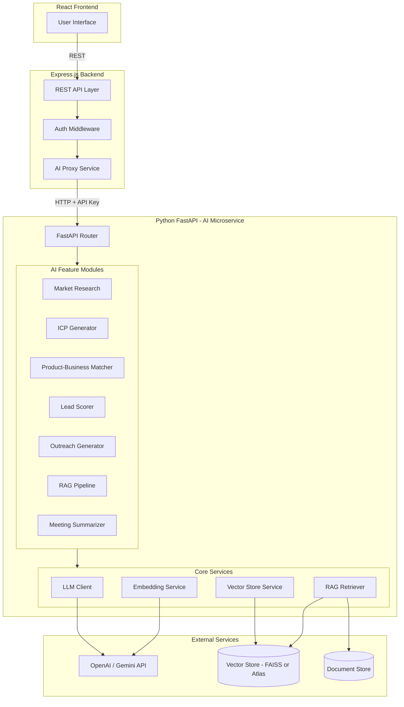
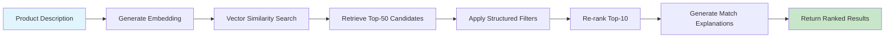
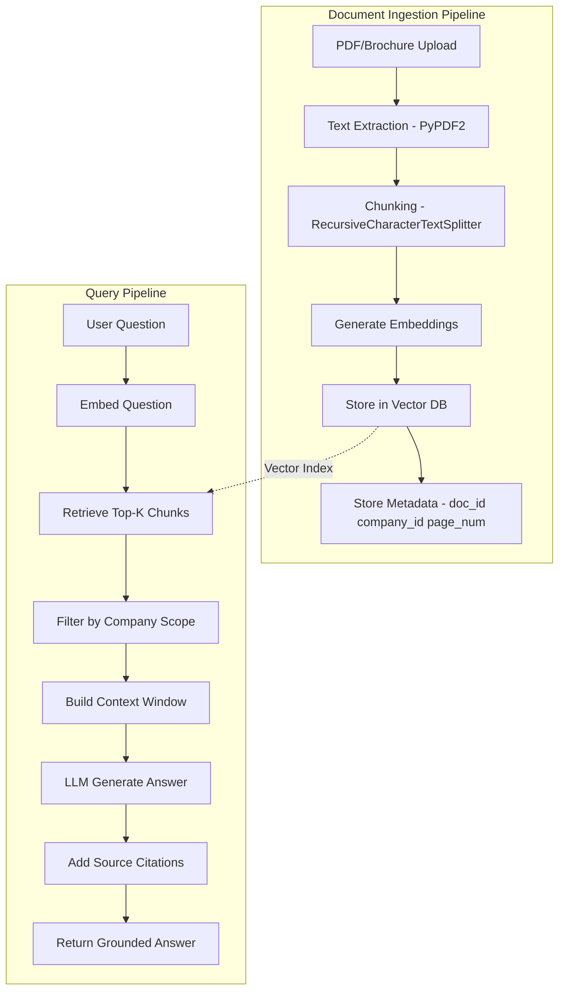

# AI Service Architecture & Implementation Guide

---

## 1. Service Overview

| Aspect | Choice | Rationale |
|---|---|---|
| **Language** | Python 3.11 | LLM ecosystem (LangChain, HuggingFace) is Python-native |
| **Framework** | FastAPI | Async, auto-docs (Swagger), Pydantic validation |
| **LLM Provider** | OpenAI GPT-4o / Google Gemini 2.0 Flash | Best-in-class reasoning; Gemini as cost-effective alternative |
| **Embeddings** | `sentence-transformers/all-MiniLM-L6-v2` (local) or OpenAI `text-embedding-ada-002` | Local = free & fast; OpenAI = higher quality |
| **Vector Store** | FAISS (dev) / MongoDB Atlas Vector Search (prod) | FAISS for zero-cost dev; Atlas for managed production |
| **Communication** | Express backend → HTTP REST → FastAPI | Clean service boundary; internal API key auth |

---

## 2. Architecture Diagram



---

## 3. Project Structure

```
ai-service/
├── app/
│   ├── main.py                  # FastAPI app, CORS, lifespan events
│   ├── config.py                # Settings from env vars (pydantic-settings)
│   │
│   ├── api/                     # Route handlers
│   │   ├── __init__.py
│   │   ├── research.py          # POST /api/ai/research
│   │   ├── icp.py               # POST /api/ai/icp
│   │   ├── matching.py          # POST /api/ai/match
│   │   ├── scoring.py           # POST /api/ai/score
│   │   ├── outreach.py          # POST /api/ai/outreach-draft
│   │   ├── rag.py               # POST /api/ai/ask
│   │   └── notes.py             # POST /api/ai/summarize-notes
│   │
│   ├── services/                # Business logic
│   │   ├── __init__.py
│   │   ├── llm.py               # LLM client (OpenAI / Gemini wrapper)
│   │   ├── embeddings.py        # Embedding generation + caching
│   │   ├── vector_store.py      # FAISS / Atlas Vector Search operations
│   │   ├── retriever.py         # RAG document retriever
│   │   └── document_processor.py # PDF/text extraction + chunking
│   │
│   ├── models/                  # Data models
│   │   ├── __init__.py
│   │   ├── schemas.py           # Pydantic request/response models
│   │   └── prompts.py           # Prompt templates (versioned)
│   │
│   └── utils/
│       ├── __init__.py
│       └── helpers.py           # Token counting, cost calculation, logging
│
├── data/
│   └── vector_indexes/          # FAISS index files (dev only)
│
├── tests/
│   ├── test_matching.py
│   ├── test_scoring.py
│   ├── test_rag.py
│   └── eval_dataset.json        # Labeled product-business pairs
│
├── requirements.txt
├── Dockerfile
└── .env.example
```

---

## 4. Feature Implementation Details

### 4.1 Market Research Assistant

**Endpoint:** `POST /api/ai/research`

**Input:**
```json
{
  "product_name": "Industrial Water Filtration System",
  "product_category": "Water Treatment Equipment",
  "specifications": "5000 L/hr capacity, stainless steel, automatic backwash",
  "target_industries": ["Manufacturing", "Food & Beverage", "Pharmaceuticals"],
  "target_city": "Pune",
  "pricing_range": "₹1.5L - ₹2.5L",
  "known_competitors": ["Aquaguard Industrial", "Kent RO Systems"]
}
```

**Process:**
1. Build a structured prompt with all input parameters
2. If RAG is available, retrieve relevant internal platform data (companies in Pune, their industries)
3. Call LLM with system instructions to produce a grounded research report
4. Parse structured JSON output

**Prompt Template:**
```python
RESEARCH_SYSTEM_PROMPT = """
You are a B2B market research analyst. Given a product and target city, produce a 
structured market research report. Follow these rules strictly:

1. ONLY include information that is factually grounded or clearly marked as an estimate.
2. NEVER fabricate market size numbers without citing a source.
3. Mark each section's confidence: HIGH (verified data), MEDIUM (reasonable estimate), LOW (hypothesis).
4. Include source references where available.
5. Identify data gaps explicitly.

Output as JSON matching the provided schema.
"""

RESEARCH_USER_PROMPT = """
Product: {product_name}
Category: {product_category}
Specifications: {specifications}
Target City: {target_city}
Target Industries: {target_industries}
Price Range: {pricing_range}
Known Competitors: {known_competitors}

{platform_context}

Generate a structured market research report.
"""
```

**Output Schema:**
```python
class ResearchSection(BaseModel):
    title: str
    content: str
    confidence: Literal["high", "medium", "low"]
    sources: list[str] = []

class MarketResearchReport(BaseModel):
    market_overview: ResearchSection
    customer_segments: list[ResearchSection]
    common_needs: ResearchSection
    competitor_landscape: ResearchSection
    geographic_clusters: ResearchSection
    regulatory_notes: ResearchSection
    research_questions: list[str]
    data_gaps: list[str]
    generated_at: datetime
    model_version: str
```

---

### 4.2 ICP (Ideal Customer Profile) Generator

**Endpoint:** `POST /api/ai/icp`

**Input:**
```json
{
  "product_name": "Industrial Water Filtration System",
  "product_description": "High-capacity water purification for manufacturing...",
  "target_market": "Western India",
  "price_range": "₹1.5L - ₹2.5L"
}
```

**Output Schema:**
```python
class IdealCustomerProfile(BaseModel):
    industry_fit: list[str]          # ["Manufacturing", "Food Processing"]
    company_size: str                 # "51-500 employees"
    geography: list[str]             # ["Pune", "Mumbai", "Ahmedabad"]
    typical_roles: list[str]         # ["Plant Manager", "Procurement Head"]
    pain_points: list[str]           # ["High maintenance costs on current system"]
    buying_signals: list[str]        # ["Recent plant expansion", "Compliance audit"]
    disqualifiers: list[str]         # ["Uses closed-loop system", "Under 20 employees"]
    estimated_deal_size: str         # "₹2L - ₹5L"
    typical_sales_cycle: str         # "2-4 months"
    recommended_approach: str        # "Technical demo focused on..."
```

**Key:** User can edit the generated ICP before saving and using it for prospect searches.

---

### 4.3 Product-to-Business Matching Pipeline

**Endpoint:** `POST /api/ai/match`



**Step-by-step:**

1. **Embed Product** — Generate embedding for the product's combined description + category + specifications using `all-MiniLM-L6-v2` (384-dim vectors)

2. **Vector Search** — Query FAISS/Atlas for top-50 semantically similar company profiles:
```python
# Using FAISS
distances, indices = index.search(product_embedding, k=50)
```

3. **Structured Filtering** — Filter candidates by:
   - Geographic proximity (if target city specified)
   - Industry match (must overlap with target industries)
   - Company size (if ICP defines a range)
   - Verification status (prefer verified companies)

4. **Re-ranking** — Score each candidate:
```python
final_score = (
    0.40 * semantic_similarity +
    0.25 * industry_relevance +
    0.15 * geographic_proximity +
    0.10 * company_activity_score +
    0.10 * verification_bonus
)
```

5. **Generate Explanations** — For top-10, call LLM to produce a 2-3 sentence match explanation:
```
"XYZ Manufacturing operates in industrial food processing and currently uses aging 
water treatment equipment. Their recent plant expansion in Pune Industrial Area 
suggests potential capacity upgrades. Recommended next step: send a product inquiry 
focused on their new production line."
```

**Output:**
```python
class MatchResult(BaseModel):
    company_id: str
    company_name: str
    match_score: float           # 0-100
    semantic_similarity: float
    industry_match: bool
    explanation: str
    missing_data: list[str]      # ["Budget not known", "Decision-maker not identified"]
    recommended_action: str      # "Send product inquiry" | "Schedule discovery call"
```

---

### 4.4 Lead Scoring Engine

**Endpoint:** `POST /api/ai/score`

**Transparent Weighted Model (v1):**

```python
SCORING_WEIGHTS = {
    "product_relevance": 0.30,    # Does the product fit the business's operations?
    "verified_need": 0.25,        # Has the business expressed/demonstrated a need?
    "budget_fit": 0.15,           # Is there evidence of budget compatibility?
    "decision_maker": 0.10,       # Is the decision-maker identified?
    "purchase_timeline": 0.10,    # Is there a known purchase window?
    "location_fit": 0.10          # Can we serve this business?
}
```

**Scoring Logic:**
```python
def score_lead(lead_data: dict) -> LeadScore:
    factors = {}
    
    # Product Relevance (0-10): AI semantic match + industry overlap
    factors["product_relevance"] = calculate_product_relevance(lead_data)
    
    # Verified Need (0-10): Has inquiry, has expressed need in meeting, has buying signals
    factors["verified_need"] = calculate_need_score(lead_data)
    
    # Budget Fit (0-10): Known budget vs product price, or UNKNOWN
    factors["budget_fit"] = calculate_budget_score(lead_data)
    
    # Decision Maker (0-10): Contact identified, role is decision-maker
    factors["decision_maker"] = calculate_authority_score(lead_data)
    
    # Timeline (0-10): Expressed purchase window, urgency signals
    factors["purchase_timeline"] = calculate_timeline_score(lead_data)
    
    # Location (0-10): Within service coverage, same city/state
    factors["location_fit"] = calculate_location_score(lead_data)
    
    # Calculate weighted total
    total = sum(factors[k] * SCORING_WEIGHTS[k] for k in SCORING_WEIGHTS)
    normalized = total * 10  # Scale to 0-100
    
    # Track missing data
    missing = [k for k, v in factors.items() if v == -1]  # -1 = unknown
    
    return LeadScore(
        score=normalized,
        factors=factors,
        weights=SCORING_WEIGHTS,
        missing_data=missing,
        score_version="v1.0",
        explanation=generate_score_explanation(factors, missing)
    )
```

**Output:**
```python
class LeadScore(BaseModel):
    score: float                          # 0-100
    grade: Literal["A", "B", "C", "D"]   # A=80+, B=60-79, C=40-59, D=<40
    factors: dict[str, float]            # Individual factor scores
    weights: dict[str, float]            # Weight per factor
    missing_data: list[str]              # Factors with unknown values
    score_version: str                   # "v1.0"
    explanation: str                     # Human-readable explanation
```

---

### 4.5 Outreach & Pitch Generator

**Endpoint:** `POST /api/ai/outreach-draft`

**Input:**
```json
{
  "salesperson_company": "TechCorp Industries",
  "product_name": "Industrial Water Filtration Pro 5000",
  "product_highlights": "5000 L/hr, stainless steel, low maintenance",
  "prospect_company": "PQR Food Processing",
  "prospect_industry": "Food & Beverage",
  "prospect_context": "Recently expanded production facility in Hinjewadi",
  "purpose": "initial_introduction",
  "tone": "professional_friendly",
  "call_to_action": "schedule_meeting"
}
```

**Prompt Template:**
```python
OUTREACH_PROMPT = """
You are a B2B sales communication assistant. Draft a personalized outreach message.

RULES:
- Be specific to the prospect's industry and context
- Reference the prospect's recent activity/news if provided
- DO NOT make claims about the prospect that aren't in the provided context
- DO NOT invent pricing, discounts, or guarantees
- Keep it concise (150-250 words)
- Include a clear call-to-action

Salesperson's Company: {salesperson_company}
Product: {product_name}
Product Highlights: {product_highlights}
Prospect Company: {prospect_company}
Prospect Industry: {prospect_industry}
Prospect Context: {prospect_context}
Purpose: {purpose}
Tone: {tone}
CTA: {call_to_action}

Generate the outreach message.
"""
```

**Key:** The salesperson MUST review and approve before sending. The UI shows the draft as editable text.

---

### 4.6 RAG Pipeline (Company Documents)



**Ingestion Pipeline:**
```python
from langchain.text_splitter import RecursiveCharacterTextSplitter

def ingest_document(file_path: str, company_id: str, doc_name: str):
    # 1. Extract text
    text = extract_text_from_pdf(file_path)
    
    # 2. Chunk with overlap
    splitter = RecursiveCharacterTextSplitter(
        chunk_size=500,
        chunk_overlap=50,
        separators=["\n\n", "\n", ". ", " "]
    )
    chunks = splitter.split_text(text)
    
    # 3. Generate embeddings
    embeddings = embedding_model.encode(chunks)
    
    # 4. Store with metadata
    for i, (chunk, embedding) in enumerate(zip(chunks, embeddings)):
        vector_store.add(
            embedding=embedding,
            metadata={
                "company_id": company_id,
                "document_name": doc_name,
                "chunk_index": i,
                "text": chunk
            }
        )
```

**Query Pipeline:**
```python
def ask_question(question: str, company_id: str) -> RAGResponse:
    # 1. Embed question
    q_embedding = embedding_model.encode(question)
    
    # 2. Retrieve top-K relevant chunks (tenant-scoped)
    results = vector_store.search(
        embedding=q_embedding,
        k=5,
        filter={"company_id": company_id}
    )
    
    # 3. Build context
    context = "\n\n".join([r.metadata["text"] for r in results])
    
    # 4. Generate grounded answer
    answer = llm.generate(
        system="Answer based ONLY on the provided context. If the answer is not "
               "in the context, say 'I don't have enough information to answer this.' "
               "Cite the document name for each fact.",
        user=f"Context:\n{context}\n\nQuestion: {question}"
    )
    
    # 5. Return with sources
    return RAGResponse(
        answer=answer,
        sources=[{
            "document": r.metadata["document_name"],
            "chunk": r.metadata["text"][:200],
            "relevance_score": r.score
        } for r in results]
    )
```

**Tenant Isolation:** Every vector store query includes `company_id` as a filter. A salesperson can only query documents from their own company's approved product library.

---

### 4.7 Meeting Notes Summarizer

**Endpoint:** `POST /api/ai/summarize-notes`

**Input:**
```json
{
  "raw_notes": "Met with Rajesh (plant manager) at their Hinjewadi facility. They currently use a 10-year old Kent system that breaks down frequently. They're looking to upgrade by Q1 2027. Budget is around 3-5 lakhs. Main concern is downtime during installation. They also want to see our maintenance contracts. Need to send them the Pro 5000 brochure and schedule a demo with their technical team next week."
}
```

**Output:**
```python
class MeetingSummary(BaseModel):
    needs: list[str]           # ["Water filtration system upgrade", "Low downtime installation"]
    objections: list[str]      # ["Concerned about downtime during installation"]
    stakeholders: list[dict]   # [{"name": "Rajesh", "role": "Plant Manager", "decision_power": "high"}]
    current_solution: str      # "10-year old Kent system, frequent breakdowns"
    budget_info: str           # "₹3-5 lakhs"
    timeline: str              # "Q1 2027"
    next_steps: list[str]      # ["Send Pro 5000 brochure", "Schedule demo with technical team"]
    follow_up_date: str        # "Next week (estimated)"
    competitive_info: str      # "Currently using Kent (competitor)"
    key_quotes: list[str]      # Notable statements from the prospect
```

---

## 5. FastAPI Endpoint Definitions

```python
from fastapi import FastAPI, Depends, HTTPException, Header
from pydantic import BaseModel
from typing import Optional

app = FastAPI(title="NearBiz AI Service", version="1.0")

# Internal API key auth
async def verify_api_key(x_api_key: str = Header(...)):
    if x_api_key != settings.INTERNAL_API_KEY:
        raise HTTPException(status_code=401, detail="Invalid API key")

@app.post("/api/ai/research", response_model=MarketResearchReport)
async def generate_research(req: ResearchRequest, _=Depends(verify_api_key)):
    """Generate market research report for a product in a target city."""
    ...

@app.post("/api/ai/icp", response_model=IdealCustomerProfile)
async def generate_icp(req: ICPRequest, _=Depends(verify_api_key)):
    """Generate ideal customer profile for a product."""
    ...

@app.post("/api/ai/match", response_model=MatchResponse)
async def match_products(req: MatchRequest, _=Depends(verify_api_key)):
    """Find matching businesses for a product using embeddings + filters."""
    ...

@app.post("/api/ai/score", response_model=LeadScore)
async def score_lead(req: ScoreRequest, _=Depends(verify_api_key)):
    """Score a lead using the transparent weighted model."""
    ...

@app.post("/api/ai/outreach-draft", response_model=OutreachDraft)
async def generate_outreach(req: OutreachRequest, _=Depends(verify_api_key)):
    """Generate personalized outreach message draft."""
    ...

@app.post("/api/ai/ask", response_model=RAGResponse)
async def rag_query(req: RAGRequest, _=Depends(verify_api_key)):
    """Answer questions using RAG over company documents."""
    ...

@app.post("/api/ai/summarize-notes", response_model=MeetingSummary)
async def summarize_notes(req: NotesRequest, _=Depends(verify_api_key)):
    """Summarize meeting notes into structured format."""
    ...

@app.post("/api/ai/ingest-document")
async def ingest_document(req: IngestRequest, _=Depends(verify_api_key)):
    """Ingest a document into the RAG vector store."""
    ...
```

---

## 6. Integration Points with Main App

| Frontend Location | AI Feature | Trigger |
|---|---|---|
| Map view | Match score badges on markers | When salesperson searches with a product filter |
| Company profile | "AI Insights" tab | When salesperson views a prospect's profile |
| Lead detail page | Lead score gauge + factor breakdown | Auto-calculated when lead is created/updated |
| Meeting prep | AI talking points | Button: "Prepare for Meeting" |
| Post-meeting | Note summarizer | Button: "Summarize Notes" in meeting outcome form |
| Discovery page | "AI Recommendations" section | Personalized product-business matches |
| Message composer | Outreach draft | Button: "AI Draft" in message editor |
| Company dashboard | Market research tool | "Research a City" wizard |
| Company settings | ICP builder | "Define Target Customer" wizard |

---

## 7. Configuration & Environment

```env
# ai-service/.env.example

# LLM Provider
LLM_PROVIDER=openai           # "openai" or "gemini"
OPENAI_API_KEY=sk-...
GEMINI_API_KEY=AIza...
LLM_MODEL=gpt-4o              # or "gemini-2.0-flash"
LLM_TEMPERATURE=0.3
LLM_MAX_TOKENS=4096

# Embeddings
EMBEDDING_MODEL=all-MiniLM-L6-v2   # Local sentence-transformer
# EMBEDDING_MODEL=text-embedding-ada-002  # OpenAI alternative

# Vector Store
VECTOR_STORE_TYPE=faiss        # "faiss" or "mongodb_atlas"
FAISS_INDEX_PATH=./data/vector_indexes
# MONGODB_URI=mongodb+srv://...   # For Atlas Vector Search

# Service
INTERNAL_API_KEY=nearbiz-internal-key-change-me
HOST=0.0.0.0
PORT=8000
LOG_LEVEL=info

# Cost Monitoring
MAX_TOKENS_PER_REQUEST=8000
MAX_REQUESTS_PER_MINUTE=60
DAILY_TOKEN_BUDGET=1000000
```

---

## 8. Cost Monitoring

```python
# Track token usage per request
class TokenTracker:
    def __init__(self):
        self.daily_usage = {"input": 0, "output": 0}
    
    def log_usage(self, input_tokens: int, output_tokens: int, feature: str):
        self.daily_usage["input"] += input_tokens
        self.daily_usage["output"] += output_tokens
        
        # Estimated cost (GPT-4o pricing)
        cost = (input_tokens * 2.5 / 1_000_000) + (output_tokens * 10.0 / 1_000_000)
        logger.info(f"AI Usage | Feature: {feature} | Tokens: {input_tokens}+{output_tokens} | Cost: ${cost:.4f}")
        
        if self.daily_usage["input"] + self.daily_usage["output"] > settings.DAILY_TOKEN_BUDGET:
            logger.warning("Daily token budget exceeded!")
```

---

## 9. Testing Strategy

### 9.1 Matching Quality Evaluation

Create a test dataset (`tests/eval_dataset.json`):
```json
[
  {
    "product": "Industrial refrigeration system, 500L capacity",
    "relevant_companies": ["cold_storage_01", "food_processor_02", "pharma_warehouse_03"],
    "irrelevant_companies": ["it_services_01", "textile_factory_02"]
  }
]
```

**Metrics:**
- **Precision@5:** What fraction of top-5 results are actually relevant?
- **Recall@10:** What fraction of all relevant companies appear in top-10?
- **Explanation Accuracy:** Are match explanations supported by actual profile fields? (human review)

### 9.2 RAG Quality Evaluation

- Upload a known brochure, ask questions with known answers
- Measure: Answer correctness, source attribution accuracy, handling of unanswerable questions

### 9.3 Score Calibration

- After accumulating enough win/loss data, compare scored leads vs actual outcomes
- Check: Do higher-scored leads actually convert more often?

---

## 10. Prompt Engineering Guidelines

1. **Always specify output format** — Use JSON schema in system prompt, parse with Pydantic
2. **Ground in context** — Always inject relevant data (company profiles, product specs) into the prompt
3. **Anti-hallucination guardrails** — Explicit instructions: "Do NOT invent specifications", "Say 'unknown' if not in context"
4. **Source attribution** — Every claim should reference a document/source
5. **Version prompts** — Store prompt versions in `prompts.py`, log which version was used
6. **Temperature control** — Use 0.2-0.3 for factual tasks, 0.5-0.7 for creative outreach

---

## 11. Deployment

```dockerfile
# ai-service/Dockerfile
FROM python:3.11-slim

WORKDIR /app

COPY requirements.txt .
RUN pip install --no-cache-dir -r requirements.txt

COPY app/ ./app/

EXPOSE 8000

CMD ["uvicorn", "app.main:app", "--host", "0.0.0.0", "--port", "8000"]
```

```txt
# requirements.txt
fastapi==0.104.1
uvicorn[standard]==0.24.0
pydantic==2.5.0
pydantic-settings==2.1.0
openai==1.6.0
google-generativeai==0.3.0
langchain==0.0.352
sentence-transformers==2.2.2
faiss-cpu==1.7.4
PyPDF2==3.0.1
python-multipart==0.0.6
httpx==0.25.2
python-dotenv==1.0.0
```
