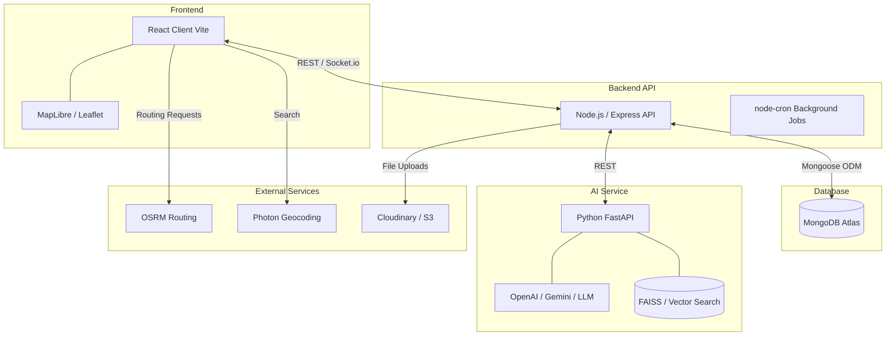

# Master Implementation Plan: NearBiz

# 1. Executive Summary

**Project Name**: NearBiz - AI-Powered Unified B2B Sales & Market Expansion Platform

The NearBiz platform is undergoing a major architectural and functional transformation. We are rebuilding it from a simple prototype (built with Vanilla JS, Express, and PostgreSQL/PostGIS) into a full-fledged, scalable, and intelligent MERN-stack web application augmented with a dedicated Python AI microservice. This transformation shifts the focus from a basic map-based lead viewer to a comprehensive B2B network that unifies discovery, social networking, CRM, meetings, and AI-driven insights into a single ecosystem.

### Current State vs Target State

| Feature Area | Current State (Prototype) | Target State (Production MERN) |
| :--- | :--- | :--- |
| **Stack** | Vanilla JS, Express 4, PostgreSQL/PostGIS | React (Vite), Express, MongoDB, Python (AI) |
| **Architecture**| Monolithic (`server.js`), Single Page HTML | Service-oriented (Frontend, API, AI microservice) |
| **Auth & Users**| None | JWT-based auth, Role-Based Access Control |
| **Data Model** | 2 tables: `clients`, `geocode_cache` | 15+ collections: `users`, `companies`, `leads`, etc. |
| **Map & Geo** | Leaflet.js, PostGIS queries | MapLibre/Leaflet, MongoDB 2dsphere indexes |
| **Social** | None | Social feed, posts, direct messaging (Socket.io) |
| **CRM** | None | Sales pipelines, opportunities, visit planning |
| **AI Integration**| None | ICP Matching, Lead Scoring, RAG, AI Outreach |

---

# 2. Architecture Transformation

**FROM**: Vanilla JS + Express + PostgreSQL MPA  
**TO**: React (Vite) + Express + MongoDB + Python AI Service

### High-Level Architecture Diagram



### Key Architectural Decisions and Rationale

*   **Why MongoDB over PostgreSQL:** The document model is an excellent fit for the highly variable data structures of company profiles, customizable product catalogs, and unstructured lead data. MongoDB’s built-in `2dsphere` indexes provide powerful geospatial querying that perfectly replaces PostGIS for our use cases, while offering a more flexible schema for rapidly evolving startup requirements.
*   **Why React (Vite) over Vanilla JS:** The target application has a large feature surface (Social Feed, Map Discovery, CRM, Messaging, Settings). React allows for component reusability, robust state management (Zustand/TanStack Query), and maintainable UI architecture. Vite provides lightning-fast HMR and optimized builds.
*   **Why separate Python AI service:** The AI ecosystem (LangChain, embeddings, RAG pipelines, HuggingFace transformers) is fundamentally Python-native. While Node.js has wrappers, building a dedicated FastAPI Python service ensures we can leverage state-of-the-art ML libraries and isolate AI compute loads from standard API web traffic.
*   **Why keep OSRM for routing:** OSRM is free, open-source, fast, and does not require costly API keys (like Google Maps API). It fulfills our needs for route optimization and polyline generation effectively.

---

# 3. Technology Stack (Final)

| Layer | Technology | Purpose |
| :--- | :--- | :--- |
| **Frontend** | React 18, Vite, Tailwind CSS, React Router, TanStack Query, React Hook Form, Zod, Socket.IO client, MapLibre GL JS (or Leaflet), Zustand | UI components, state management, form validation, real-time updates, mapping, and routing. |
| **Backend API** | Node.js 18, Express 4, Mongoose, JWT + bcryptjs, multer, sharp, Socket.IO, node-cron | Core business logic, REST APIs, WebSocket management, authentication, scheduled tasks, image processing. |
| **Database** | MongoDB Atlas (or local) with Mongoose ODM | Primary data store, leveraging `2dsphere` indexes for geographic discovery. |
| **AI Service** | Python 3.11, FastAPI, LangChain, OpenAI/Gemini API, sentence-transformers, FAISS (or Atlas Vector Search), pydantic | AI operations: Ideal Customer Profile (ICP) generation, lead scoring, AI outreach drafting, RAG pipelines. |
| **External** | OSRM, Photon, Cloudinary or S3 | Routing capabilities, address geocoding, and scalable media file storage. |
| **DevOps** | Docker Compose, GitHub Actions | Local development orchestration, automated testing, and CI/CD pipelines. |

---

# 4. Development Phases Overview

### Phase 1: Foundation (Weeks 1-3)
*   **Goals:** Setup the core stack, implement authentication, and establish basic data models.
*   **Key Deliverables:** Monorepo setup, JWT Auth flow, User and Company profile management, Image uploads.
*   **Files to create:** `server/src/models/User.js`, `server/src/models/Company.js`, `client/src/features/auth/*`, boilerplate server and client setups.

### Phase 2: Discovery & Map (Weeks 4-6)
*   **Goals:** Rebuild map functionality using React, integrate MongoDB geospatial queries, build search.
*   **Key Deliverables:** Map view with clusters, nearby search, business card UI on map pins, rich filtering.
*   **Files to create:** `client/src/features/map/*`, `server/src/routes/map.routes.js`, GeoJSON adapters.

### Phase 3: Social & Communication (Weeks 7-9)
*   **Goals:** Transform the map tool into a network platform.
*   **Key Deliverables:** Social feed (posts, likes, comments), Real-time direct messaging (Socket.io), Meeting scheduler and requests.
*   **Files to create:** `server/src/models/Post.js`, `server/src/models/Message.js`, `client/src/features/feed/*`, `client/src/features/messaging/*`.

### Phase 4: AI Integration (Weeks 10-13)
*   **Goals:** Infuse intelligence into the platform via the Python microservice.
*   **Key Deliverables:** Python API setup, AI Lead Matching, ICP analysis, automated outreach drafting, platform RAG search.
*   **Files to create:** `ai-service/app/api/*`, `ai-service/app/services/llm_service.py`, Express-to-FastAPI proxy routes.

### Phase 5: CRM & Polish (Weeks 14-16)
*   **Goals:** Complete the B2B sales lifecycle and prepare for deployment.
*   **Key Deliverables:** Leads pipeline (Kanban board), Opportunities, Visit planning/routing UI, Analytics dashboard, final styling.
*   **Files to create:** `client/src/features/crm/*`, `server/src/models/Lead.js`, `docker-compose.yml`.

---

# 5. Repository Structure

```
final/
├── client/                    # React frontend (Vite)
│   ├── public/
│   ├── src/
│   │   ├── components/        # Reusable UI components
│   │   ├── features/          # Feature modules
│   │   │   ├── auth/
│   │   │   ├── company/
│   │   │   ├── map/
│   │   │   ├── feed/
│   │   │   ├── meetings/
│   │   │   ├── crm/
│   │   │   ├── messaging/
│   │   │   └── ai/
│   │   ├── hooks/
│   │   ├── services/          # API client, socket, auth
│   │   ├── stores/            # Zustand stores
│   │   ├── layouts/
│   │   ├── pages/
│   │   ├── utils/
│   │   ├── App.jsx
│   │   └── main.jsx
│   ├── index.html
│   ├── tailwind.config.js
│   ├── vite.config.js
│   └── package.json
├── server/                    # Express backend
│   ├── src/
│   │   ├── config/
│   │   ├── middleware/
│   │   ├── models/            # Mongoose schemas
│   │   ├── routes/
│   │   ├── services/
│   │   ├── jobs/              # Background tasks
│   │   ├── utils/
│   │   └── app.js
│   ├── server.js
│   ├── .env.example
│   └── package.json
├── ai-service/                # Python AI microservice
│   ├── app/
│   │   ├── api/
│   │   ├── services/
│   │   ├── models/
│   │   └── main.py
│   ├── requirements.txt
│   └── Dockerfile
├── docker-compose.yml
└── README.md
```

---

# 6. Data Model Overview

Below is a brief overview of the primary MongoDB collections:

*   **users:** Authentication credentials, basic profile, role (`salesperson`, `company_admin`, etc.).
*   **companies:** Business entity details, location (GeoJSON `Point`), industry, size, description.
*   **memberships:** Junction collection linking users to companies with specific roles.
*   **products:** Items/services offered by companies.
*   **posts:** Social feed items created by companies or users.
*   **leads:** Saved prospects for a salesperson (includes CRM status/stage).
*   **opportunities:** Financial representation of a potential sale linked to a lead.
*   **conversations / messages:** Real-time chat data structures.
*   **meetingRequests / meetings:** Calendar events and pending requests between users.
*   **activities:** Audit logs and CRM activity history (calls, visits, emails).
*   **notifications:** In-app user alerts.
*   **aiReports:** Cached results from long-running AI tasks (e.g., extensive market analysis).

---

# 7. API Endpoint Summary

*   **Auth (7 endpoints):** `/auth/register`, `/auth/login`, `/auth/me`, `/auth/refresh`, `/auth/reset-password`...
*   **Companies (15+ endpoints):** `/companies`, `/companies/:id`, `/companies/:id/members`, `/companies/search`...
*   **Products (5 endpoints):** `/companies/:id/products`, `/products/:id`...
*   **Map/Discovery (5 endpoints):** `/map/nearby`, `/map/route`, `/map/clusters`, `/map/geocode`...
*   **Feed/Posts (10+ endpoints):** `/feed`, `/posts`, `/posts/:id/like`, `/posts/:id/comments`...
*   **Meetings (8 endpoints):** `/meetings`, `/meetings/requests`, `/meetings/:id/accept`...
*   **Messaging (5 endpoints):** `/conversations`, `/conversations/:id/messages`...
*   **CRM/Leads (8 endpoints):** `/crm/leads`, `/crm/leads/:id/stage`, `/crm/opportunities`...
*   **AI (6 endpoints):** `/ai/match`, `/ai/score`, `/ai/outreach`, `/ai/icp-analysis`...
*   **Users/Notifications (5 endpoints):** `/users/:id`, `/notifications`, `/notifications/read`...
*   **Upload (3 endpoints):** `/upload/image`, `/upload/document`...

---

# 8. User Roles & Permissions Matrix

| Capability | Salesperson | Company Member | Company Admin | Platform Admin |
| :--- | :---: | :---: | :---: | :---: |
| Browse Map & Discover | ✅ | ✅ | ✅ | ✅ |
| Access Social Feed | ✅ | ✅ | ✅ | ✅ |
| Manage Own CRM/Leads | ✅ | ❌ | ❌ | ✅ |
| Create Meeting Requests | ✅ | ✅ | ✅ | ✅ |
| Edit Company Profile | ❌ | ❌ | ✅ | ✅ |
| Manage Products | ❌ | ✅ | ✅ | ✅ |
| Manage Company Users | ❌ | ❌ | ✅ | ✅ |
| Access System Metrics | ❌ | ❌ | ❌ | ✅ |

---

# 9. Cross-Reference to Detailed Plans

For granular implementation details, refer to the following phase-specific documents:

*   `01-PHASE1-FOUNDATION.md`
*   `02-PHASE2-DISCOVERY-MAP.md`
*   `03-PHASE3-SOCIAL-COMMUNICATION.md`
*   `04-PHASE4-AI-INTEGRATION.md`
*   `05-PHASE5-CRM-POLISH.md`
*   `06-DATABASE-SCHEMA.md`
*   `07-AI-ARCHITECTURE.md`
*   `08-API-REFERENCE.md`

---

# 10. MVP Definition

The Minimum Viable Product (MVP) demo scenario that proves end-to-end value:

1.  **Onboarding:** A `Company Admin` registers their business and publishes a key product offering.
2.  **Discovery:** A `Salesperson` logs in, selects a target city, and opens the interactive map.
3.  **Contextual Mapping:** The map populates with nearby businesses, visually indicating industries and available product details upon clicking.
4.  **AI Augmentation:** The salesperson triggers the AI service, which suggests highly relevant prospects in the viewport based on their ICP, providing clear "match explanations" and a 1-100 score.
5.  **Action:** The salesperson saves a top-scored lead to their CRM and sends a meeting request.
6.  **Interaction:** The targeted company receives a notification and accepts the meeting request.
7.  **Planning:** The salesperson adds the confirmed meeting to their daily visit plan; the map generates an optimized route using OSRM.
8.  **Closing the Loop:** Post-meeting, the salesperson logs the outcome in the CRM, advancing the lead stage from "Meeting Set" to "Negotiation."
